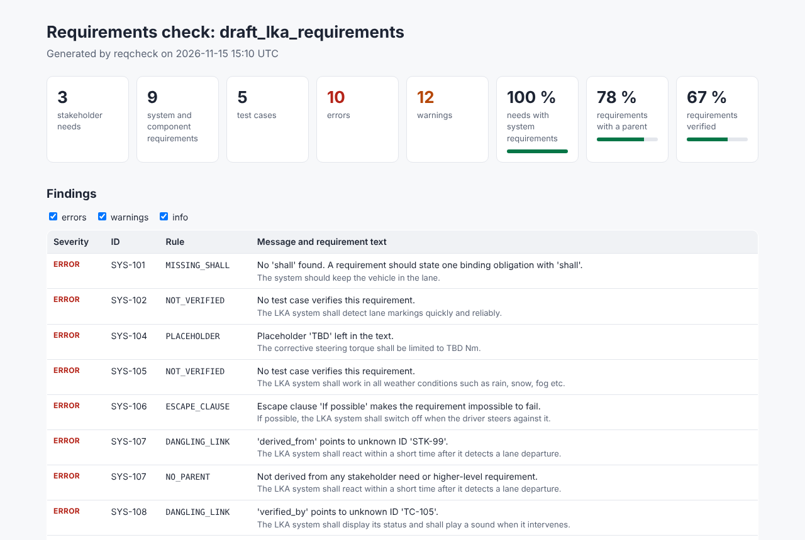

# reqcheck: requirement quality and traceability checks


`reqcheck` reviews requirements the way a systems engineer would before a review meeting, but automatically and on every commit. It:

- **checks how each requirement is written**: missing or multiple "shall", vague words, escape clauses, TBDs, "and/or", passive voice, comparisons without numbers, and whether the sentence follows an [EARS](https://alistairmavin.com/ears/) pattern. The rules are inspired by the INCOSE *Guide to Writing Requirements*.
- **checks traceability**: stakeholder need → system requirement → component requirement → test case. It reports broken links, requirements without a parent, needs with no requirement, requirements without a test, and tests that verify nothing.
- **reads and writes ReqIF**, the exchange format used by DOORS, DOORS Next, Polarion and codebeamer, as well as YAML and CSV.
- **writes reports** as HTML (with a traceability matrix) and Markdown, and **fails the build** in CI when errors appear or verification coverage drops below a limit.



## Why

In ASPICE-style projects (SYS.2 to SYS.5), every requirement must be clear, verifiable and traceable in both directions. Manual reviews catch most problems, but late and inconsistently. Running simple, explainable checks on every change finds problems early and keeps coverage numbers current for reviews and audits.

## Quick start

```bash
git clone https://github.com/Pavan-Kulkarni314/reqcheck.git
cd reqcheck
pip install -e ".[dev]"

# Example 1: the Adaptive Cruise Control requirements (passes, 3 open points)
reqcheck check examples/acc_requirements.yaml --html acc_report.html

# Example 2: a deliberately weak first draft for a lane keeping assistant (fails)
reqcheck check examples/draft_lka_requirements.csv --html draft_report.html --show-info

# Convert to ReqIF for import into a requirements management tool
reqcheck convert examples/acc_requirements.yaml acc_requirements.reqif

# List all rules
reqcheck rules
```

Example output for the draft:

```text
  ERROR    SYS-104      PLACEHOLDER      Placeholder 'TBD' left in the text.
  ERROR    SYS-106      ESCAPE_CLAUSE    Escape clause 'If possible' makes the requirement impossible to fail.
  ERROR    SYS-107      DANGLING_LINK    'derived_from' points to unknown ID 'STK-99'.
  WARNING  SYS-102      VAGUE_TERM       Vague term 'quickly'. Replace it with a measurable value.
  WARNING  SYS-103      AND_OR           'and/or' is ambiguous. State whether both or either is required.
  WARNING  SYS-107      UNQUANTIFIED     'within a short time' has no number. Add a value with a unit.
  ...
  Errors: 10   Warnings: 12   Info: 5
  Requirements verified by tests: 66.7 %
  FAILED: 10 error(s)
```

Full example reports: [ACC](docs/example_report_acc.md) · [LKA draft](docs/example_report_draft.md)

## Input formats

**YAML**

```yaml
project: Adaptive Cruise Control (ACC)
requirements:
  - id: SYS-08
    type: system            # stakeholder | system | component
    text: When the driver presses the brake pedal, the ACC system shall switch to standby within 100 ms.
    derived_from: [STK-03]
tests:
  - id: TC-07
    method: test            # test | analysis | inspection | demonstration
    text: "HIL: with ACC active at 80 km/h, send a brake pedal signal and measure the time until standby."
    verifies: [SYS-08]
```

**CSV**: columns `id, type, text, derived_from, verified_by, verifies, method`. Lists are separated by `;` or `,`. If `type` is missing, it is taken from the ID prefix (`STK`, `SYS`, `CMP`, `TC`).

**ReqIF**: attributes are matched by name (`ReqIF.ForeignID` / `ID` / `Object Identifier`, `ReqIF.Text` / `Object Text`, `Type`). XHTML text is supported. Relation types containing "derive", "refine" or "trace" become parent links, and those containing "verif" become test links. Files written by `reqcheck convert` validate against the OMG ReqIF 1.0 XML schema.

## Rules

| Rule | Severity | What it finds |
|---|---|---|
| `MISSING_SHALL` | error | No "shall" in a system or component requirement |
| `ESCAPE_CLAUSE` | error | "if possible", "where applicable", ... |
| `PLACEHOLDER` | error | TBD, TBC, "to be defined", ... |
| `MULTIPLE_SHALL` | warning | More than one "shall": not singular |
| `WEAK_MODAL` | warning | should / may / will / must / can |
| `VAGUE_TERM` | warning | fast, user-friendly, sufficient, robust, ... |
| `OPEN_ENDED` | warning | etc., such as, including but not limited to |
| `AND_OR` | warning | "and/or" |
| `ABSOLUTE` | warning | always, never, all conditions, 100 % |
| `PASSIVE_VOICE` | warning | "shall be limited": who does it? |
| `UNQUANTIFIED` | warning | within / at least / up to ... without a number |
| `PRONOUN` | info | it, its, they, this, ... |
| `NOT_EARS` | info | Not in an EARS sentence pattern |
| `TOO_LONG` | info | More than 40 words |

Traceability checks: `DUPLICATE_ID`, `DANGLING_LINK`, `WRONG_LINK_TYPE`, `NO_PARENT`, `NO_CHILD`, `NOT_VERIFIED`, `ORPHAN_TEST`.

The rules are heuristics: a finding means *a reviewer should look at this*. Disable a rule with `--disable RULE_ID`.

## Using it in CI

```bash
reqcheck check requirements.reqif --fail-on error --min-verification-coverage 90 --html report.html
```

Exit codes: `0` passed, `1` errors found or coverage below the limit, `2` the input could not be read. See [.github/workflows/ci.yml](.github/workflows/ci.yml): it runs the tests on Python 3.10–3.13, checks the example requirements and uploads the HTML reports as build artifacts.

## Project structure

```text
src/reqcheck/
  model.py     Item, Finding, Project
  loaders.py   YAML, CSV and ReqIF readers
  rules.py     quality rules and EARS pattern detection
  trace.py     traceability checks and coverage
  report.py    console, Markdown and HTML reports
  writers.py   ReqIF, CSV and YAML writers
  cli.py       command line interface
tests/         unit tests (pytest)
examples/      ACC requirements (YAML, ReqIF) and a weak LKA draft (CSV)
```

## Related

The ACC requirements come from the SysML v2 model in [acc-sysml-v2](https://github.com/Pavan-Kulkarni314/acc-sysml-v2), which uses the same IDs.

## Author

Pavan Kulkarni, M.Sc. Systems Engineering for Manufacturing (OVGU Magdeburg) · [LinkedIn](https://www.linkedin.com/in/pavan-kulkarni)

All example requirements are illustrative and based on public literature. They contain no company data.

## License

MIT
